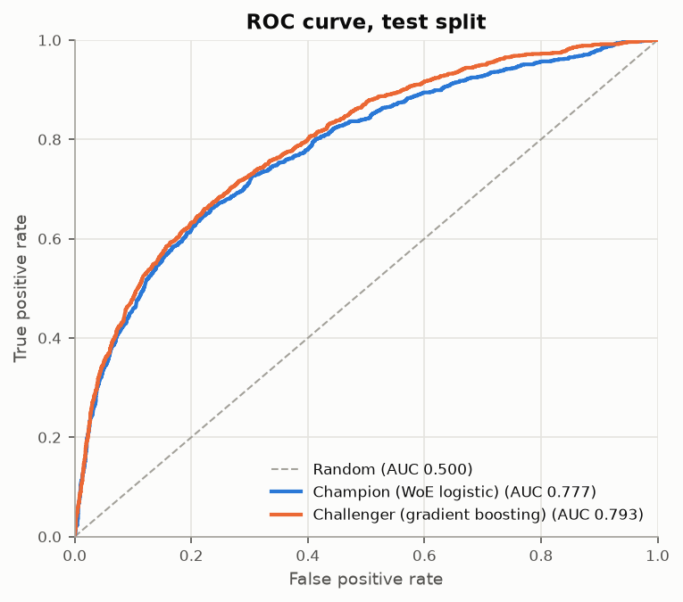
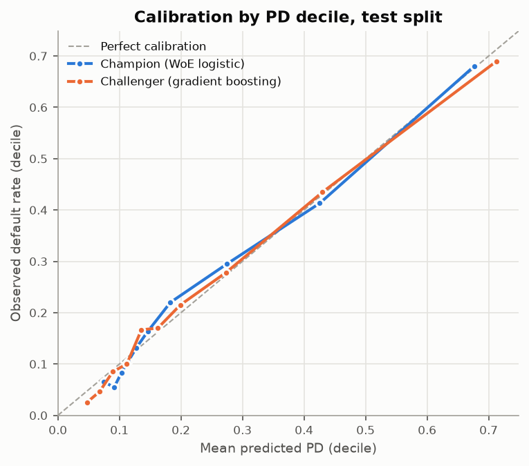

# Credit-card default: PD model and validation

## The problem

A card lender needs an estimate, for each account, of the probability that it will default (PD). That estimate drives line management, collections priority and expected-loss forecasts, so it has to be checked before anyone relies on it: is the input data sound, does the model rank risk well, are its probabilities accurate, will it hold up on new data, and where does it fail?

This repository builds a PD model on public credit-card data and then validates it in the format a model-risk team uses. It is an independent portfolio project; no lender or private data is involved.

## Data

[Default of Credit Card Clients](https://doi.org/10.24432/C55S3H) from the UCI Machine Learning Repository: 30,000 card accounts from a bank in Taiwan, with credit limit, demographics, and six months (April to September 2005) of bill amounts, payment amounts and repayment status. The target is whether the account defaulted on the following month's payment. The file is not committed; `make data` downloads it and verifies it against `data/checksums.sha256`.

## Approach

1. **SQL pipeline (DuckDB).** The workbook is loaded to a raw table, then SQL files build a staging layer (renamed columns, explicit handling of undocumented category codes, a long account-month table) and 20 behavioural features: utilisation, bill trends, delinquency counts and streaks, payment ratios. A stratified train/validation/test split (60/20/20) is also done in SQL. Feature definitions and lineage: [`docs/data_dictionary.md`](docs/data_dictionary.md).
2. **Data-quality checks in SQL.** Row counts, key uniqueness, nulls, value ranges, documented-versus-observed codes, raw-to-staging reconciliation and feature logic. Error-level failures stop the pipeline.
3. **Models.** Champion: logistic regression on weight-of-evidence bins, scaled to scorecard points. Challenger: gradient boosting on the raw features. Hyperparameters are chosen on the validation split; the test split is used only for the report. Demographic fields are excluded from both models.
4. **Validation.** [`reports/model_validation.md`](reports/model_validation.md) covers purpose, data, data quality, methodology, discrimination (AUC, Gini, KS, Brier), calibration by decile, stability (score and feature PSI), sensitivity, a champion-challenger benchmark, limitations and findings. Every number in it is generated by the pipeline.

## Results

<!-- results:start -->
Test split (6,000 accounts, not used for fitting or tuning):

| Model | AUC | Gini | KS | Brier | Mean PD |
| :--- | ---: | ---: | ---: | ---: | ---: |
| Champion (WoE logistic) | 0.777 | 0.555 | 0.427 | 0.1374 | 22.2% |
| Challenger (gradient boosting) | 0.793 | 0.587 | 0.438 | 0.1345 | 22.3% |

- Challenger minus champion test AUC: 0.016 (95% paired bootstrap CI 0.009 to 0.022).
- Champion calibration: mean PD 22.2% vs observed 22.1%; Hosmer-Lemeshow p = 0.0044.
- Champion score PSI, train vs test: 0.0010 (random split, so this checks the split rather than stability over time).
- Data quality: 27 SQL checks, 0 failures, 5 warnings for documented code and balance issues.
<!-- results:end -->

| ROC, test split | Calibration by decile, test split |
| :---: | :---: |
|  |  |

The full report lists its findings with recommendations, from the missing out-of-time test to decile-level miscalibration and non-monotone bins.

## How to run

Requires Python 3.10+ and `make`.

```bash
pip install -r requirements.txt
make all     # data -> SQL pipeline -> data-quality checks -> models -> validation -> figures -> report
make test    # pytest: SQL data-quality runner, feature SQL, model smoke test, metrics
```

Individual steps: `make data`, `make pipeline`, `make dq`, `make models`, `make validate`, `make figures`, `make report`. A full run takes about a minute after the download.

```
sql/staging/     raw -> staging (accounts, account-months)
sql/features/    staging -> features, train/validation/test split
sql/dq/          data-quality checks (one row per check)
sql/profiles/    documented vs observed category codes
src/cdmv/        download, SQL runner, DQ runner, WoE binning, models, metrics, figures, report
reports/         model_validation.md, figures/, tables/ (CSV outputs behind the report)
tests/           pytest suite on synthetic data
```

## Limitations

- One observation window (2005) and one outcome month, so there is no out-of-time test; the PSI figures compare random samples of the same period.
- Old data from a single lender in one market; results do not carry over to current portfolios.
- The target is "default next month", not a 12-month default definition, and is not defined in days past due.
- Repayment-status codes -2 and 0 cover most account-months but are not documented by the source; their reading as "not delinquent" is an assumption.
- Development and validation were done by the same person, so the validation is not independent.

## License and citation

Code: MIT (see `LICENSE`). Data: CC BY 4.0, not redistributed here.

Yeh, I. (2009). Default of Credit Card Clients [Dataset]. UCI Machine Learning Repository. https://doi.org/10.24432/C55S3H

Yeh, I. C., & Lien, C. H. (2009). The comparisons of data mining techniques for the predictive accuracy of probability of default of credit card clients. *Expert Systems with Applications*, 36(2), 2473-2480.
