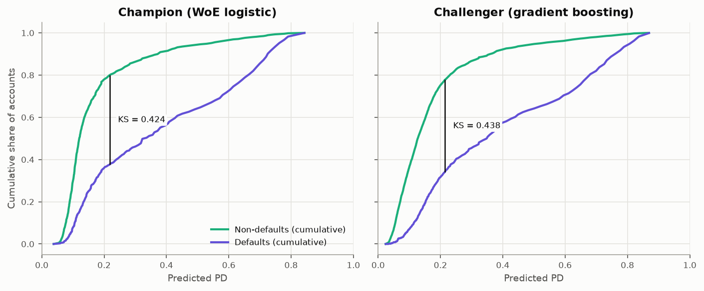
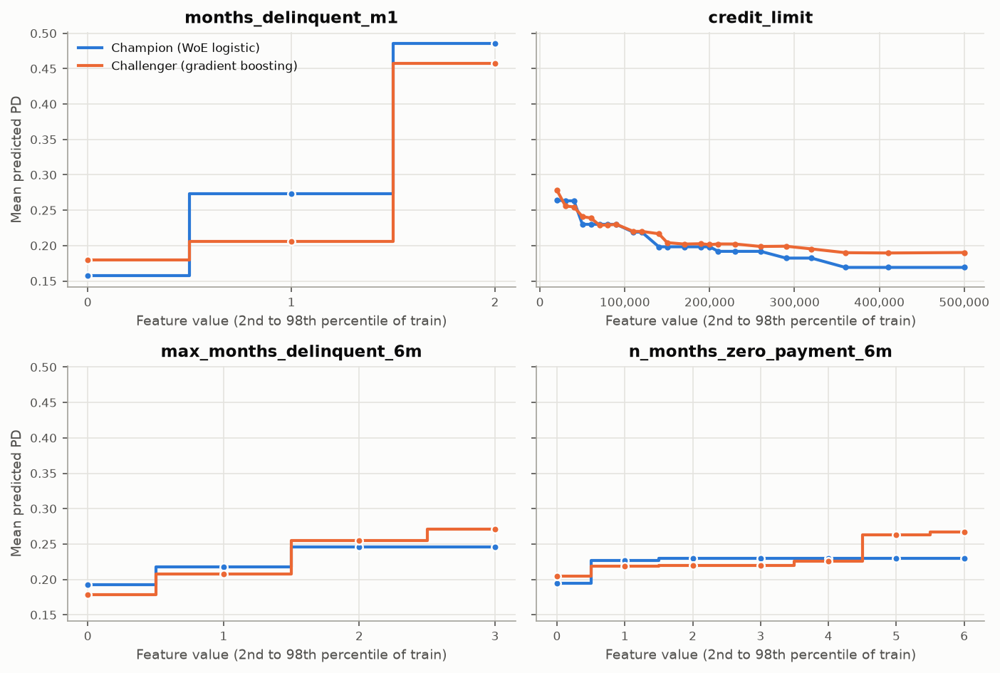
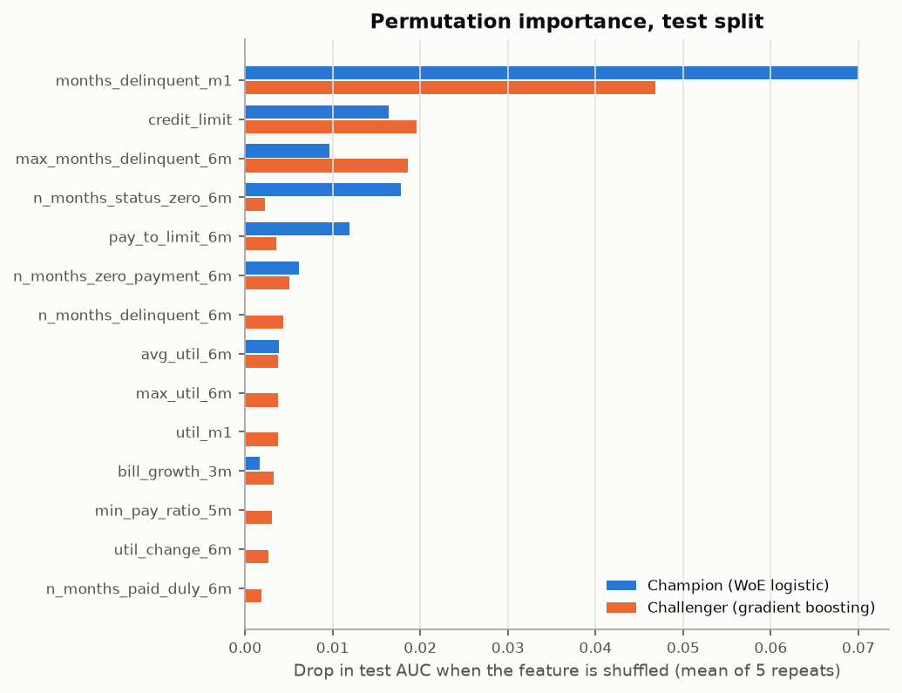

# Model validation report: credit-card probability of default

> Generated by `make report` from the pipeline outputs. Every number below is computed by the code in `src/cdmv/` or set as a named threshold in it; the exceptions are dates, citations and general facts about the source data and lending practice. This is an independent portfolio project on public data, written in the format of a model-risk validation.

| Item | Description |
| :--- | :--- |
| Model | Probability of default (PD), next-month payment default, credit-card accounts |
| Champion | Champion (WoE logistic), 11 features, scorecard scaling 600 points at 50:1 odds, 20 points to double the odds |
| Challenger | Challenger (gradient boosting), 20 features |
| Data | UCI Default of Credit Card Clients, 30,000 accounts, Taiwan, 2005 |
| Validation scope | Data quality, methodology, discrimination, calibration, stability, sensitivity, benchmarking |

## Summary

The champion separates defaulters from non-defaulters with a test AUC of 0.776 and KS of 0.424, above the thresholds this report uses (AUC 0.70, KS 0.30). Mean predicted PD on test is 22.1% against an observed default rate of 22.1%. The gradient-boosting challenger reaches a test AUC of 0.793; the paired bootstrap difference is 0.017 (95% CI 0.010 to 0.024). 27 data-quality checks ran with 0 failures and 5 warnings for known, documented issues.

The validation raises 6 findings: 1 high, 3 medium, 2 low. The high-severity finding is the missing out-of-time test. The model is suitable as a documented demonstration of PD development and validation; it should not be used for decisions on real accounts.

### Headline metrics (test split)

| Model | AUC | Gini | KS | Brier | Mean PD |
| :--- | ---: | ---: | ---: | ---: | ---: |
| Champion (WoE logistic) | 0.776 | 0.552 | 0.424 | 0.1373 | 22.1% |
| Challenger (gradient boosting) | 0.793 | 0.587 | 0.438 | 0.1345 | 22.3% |

### Findings

| ID | Area | Severity | Finding | Recommendation |
| :--- | :--- | :--- | :--- | :--- |
| F1 | Stability | High | No out-of-time test is possible: the data covers one observation point (six monthly snapshots, April to September 2005) and one outcome month. The train/test PSI values reported below compare random samples of the same population, so they confirm the split, not stability over time. | Before any use beyond demonstration, test on a later vintage and set PSI monitoring triggers (0.10 review, 0.25 redevelop). |
| F2 | Benchmark | Medium | The challenger's test AUC is higher by 0.017 (95% paired bootstrap CI 0.010 to 0.024), so the champion's simpler form gives up measurable discrimination. | Document the interpretability trade-off, or test whether interaction terms or segment-level models close the gap. |
| F3 | Methodology | Low | 2 champion features change test AUC by less than 0.0005 when shuffled (`util_change_6m` and `pay_ratio_m1`). | Remove them for parsimony unless they are kept for business reasons. |
| F4 | Performance | Low | The challenger's train AUC exceeds its test AUC by 0.021; for the champion the train-minus-test gap is -0.006. The challenger shows some overfitting. | Tighten regularisation (fewer leaves, larger minimum leaf size) or use early stopping. |
| F5 | Data | Medium | Repayment status codes -2 and 0 are not defined in the source documentation but make up 66.9% of account-months. The model treats them as not delinquent, which is the common reading but is not confirmed. | Confirm code definitions with the data owner; rerun if the reading changes. |
| F6 | Governance | Medium | Development and validation were done by the same person. This report follows the structure of an independent validation but is not one. | Have an independent reviewer repeat the key tests. |

## 1. Purpose and intended use

The model estimates, for each credit-card account, the probability that the account defaults on its next monthly payment, using the previous six months of limit, billing, payment and repayment-status history. In a lending setting a PD model of this kind would feed account management (line decreases, collections prioritisation) and expected-loss estimates. Here the intended use is narrower: to show a reproducible development and validation process on public data. Out of scope: origination decisions, regulatory capital, and any decision about a real customer.

## 2. Data

Source: UCI Machine Learning Repository, dataset 350 (Yeh, 2009, CC BY 4.0). 30,000 credit-card accounts from a bank in Taiwan; one row per account; six monthly snapshots from April to September 2005 (unpivoted to 180,000 account-months in staging). The target is `default payment next month` (1 = default), with an overall default rate of 22.12%. The source does not define default more precisely (for example days past due), so the target definition is taken as given.

The split is stratified by target and done in SQL (`sql/features/020_model_split.sql`) by ordering accounts on an md5 hash of the account id and a fixed seed. Validation data is used only to choose hyperparameters; test data is used only for this report.

| Split | Accounts | Defaults | Default rate | Share |
| :--- | ---: | ---: | ---: | ---: |
| train | 18,000 | 3,982 | 22.12% | 60.0% |
| validation | 6,000 | 1,327 | 22.12% | 20.0% |
| test | 6,000 | 1,327 | 22.12% | 20.0% |

There is no time dimension beyond the six snapshots and a single outcome month, so the test split is an out-of-sample holdout from the same period, not an out-of-time sample (finding F1).

## 3. Data quality

Checks are SQL queries in `sql/dq/`, run by `src/cdmv/dq.py` after every build. A check with severity `error` and any failing rows stops the pipeline with a non-zero exit code; `warn` records a known issue that staging handles explicitly.

| Check | Layer | Rule | Severity | Failing rows | Rows | Status |
| :--- | :--- | :--- | :--- | ---: | ---: | :--- |
| RAW_01 | raw | Row count equals documented 30000 | error | 0 | 30,000 | PASS |
| RAW_02 | raw | ID is unique | error | 0 | 30,000 | PASS |
| RAW_03 | raw | No nulls in any of the 25 columns | error | 0 | 30,000 | PASS |
| RAW_04 | raw | Target is 0 or 1 | error | 0 | 30,000 | PASS |
| RAW_05 | raw | LIMIT_BAL is positive | error | 0 | 30,000 | PASS |
| RAW_06 | raw | AGE between 18 and 100 | error | 0 | 30,000 | PASS |
| RAW_07 | raw | SEX in documented codes {1,2} | error | 0 | 30,000 | PASS |
| RAW_08 | raw | PAY_0..PAY_6 within observed range [-2, 9] | error | 0 | 30,000 | PASS |
| RAW_09 | raw | PAY_AMT1..6 non-negative | error | 0 | 30,000 | PASS |
| RAW_10 | raw | EDUCATION in documented codes {1,2,3,4} (0/5/6 mapped to 4 in staging) | warn | 345 | 30,000 | WARN |
| RAW_11 | raw | MARRIAGE in documented codes {1,2,3} (0 mapped to 3 in staging) | warn | 54 | 30,000 | WARN |
| RAW_12 | raw | PAY_0..PAY_6 in documented codes {-1,1..9} (-2 and 0 are undocumented) | warn | 25,939 | 30,000 | WARN |
| RAW_13 | raw | BILL_AMT1..6 non-negative (negative = credit balance) | warn | 1,930 | 30,000 | WARN |
| RAW_14 | raw | BILL_AMT1..6 at or below LIMIT_BAL (above = over limit) | warn | 3,931 | 30,000 | WARN |
| STG_01 | staging | stg_accounts row count equals raw row count | error | 0 | 30,000 | PASS |
| STG_02 | staging | Every raw ID has exactly one staging row and vice versa | error | 0 | 30,000 | PASS |
| STG_03 | staging | Mapped EDUCATION in {1..4} and MARRIAGE in {1..3} | error | 0 | 30,000 | PASS |
| STG_04 | staging | stg_account_months has exactly 6 months per account | error | 0 | 30,000 | PASS |
| STG_05 | staging | Monthly bill and payment totals reconcile to raw | error | 0 | 30,000 | PASS |
| FEA_01 | features | account_features row count equals stg_accounts | error | 0 | 30,000 | PASS |
| FEA_02 | features | Every feature row joins to one staging account (unique key) | error | 0 | 30,000 | PASS |
| FEA_03 | features | No null or non-finite model features | error | 0 | 30,000 | PASS |
| FEA_04 | features | Payment ratios within [0, 1] | error | 0 | 30,000 | PASS |
| FEA_05 | features | Month counts within [0, 6] and status counts sum to 6 | error | 0 | 30,000 | PASS |
| FEA_06 | features | Streak logic: current <= longest <= delinquent months | error | 0 | 30,000 | PASS |
| FEA_07 | features | Every account is in exactly one split | error | 0 | 30,000 | PASS |
| FEA_08 | features | Split default rates within 0.5 pp of overall (stratification) | error | 0 | 30,000 | PASS |

Documented versus observed category codes (from `sql/profiles/category_codes.sql`; PAY counts are account-months across PAY_0 to PAY_6):

| Field | Code | Count | Documented meaning | Documented |
| :--- | ---: | ---: | :--- | :--- |
| EDUCATION | 0 | 14 | undocumented | **no** |
| EDUCATION | 1 | 10,585 | graduate school | yes |
| EDUCATION | 2 | 14,030 | university | yes |
| EDUCATION | 3 | 4,917 | high school | yes |
| EDUCATION | 4 | 123 | others | yes |
| EDUCATION | 5 | 280 | undocumented | **no** |
| EDUCATION | 6 | 51 | undocumented | **no** |
| MARRIAGE | 0 | 54 | undocumented | **no** |
| MARRIAGE | 1 | 13,659 | married | yes |
| MARRIAGE | 2 | 15,964 | single | yes |
| MARRIAGE | 3 | 323 | others | yes |
| PAY_0..PAY_6 | -2 | 24,415 | undocumented | **no** |
| PAY_0..PAY_6 | -1 | 34,640 | pay duly | yes |
| PAY_0..PAY_6 | 0 | 95,919 | undocumented | **no** |
| PAY_0..PAY_6 | 1 | 3,722 | payment delay 1 month(s) | yes |
| PAY_0..PAY_6 | 2 | 18,964 | payment delay 2 month(s) | yes |
| PAY_0..PAY_6 | 3 | 1,430 | payment delay 3 month(s) | yes |
| PAY_0..PAY_6 | 4 | 453 | payment delay 4 month(s) | yes |
| PAY_0..PAY_6 | 5 | 137 | payment delay 5 month(s) | yes |
| PAY_0..PAY_6 | 6 | 74 | payment delay 6 month(s) | yes |
| PAY_0..PAY_6 | 7 | 218 | payment delay 7 month(s) | yes |
| PAY_0..PAY_6 | 8 | 28 | payment delay 8 month(s) | yes |

Treatment: EDUCATION codes 0, 5 and 6 are mapped to 4 (others) and MARRIAGE code 0 to 3 (others), with flags kept in staging; neither field is a model input. PAY codes -2 and 0 are kept as distinct values and counted separately (`n_months_status_neg2_6m`, `n_months_status_zero_6m`); both are treated as not delinquent (`months_delinquent = greatest(pay_status, 0)`). A common reading is -2 = no balance or no use and 0 = revolving credit paid at least the minimum, but the source does not confirm this (finding F5). Negative bills are credit balances and bills above the limit are over-limit accounts; both are kept.

## 4. Methodology

### 4.1 Features

20 candidate features are built in SQL (`sql/features/010_account_features.sql`) from limit, bill, payment and repayment-status fields: utilisation level, peak and trend; bill growth; over-limit months; delinquency level, counts and streaks (gaps-and-islands on the monthly table); counts of each repayment-status type; payment ratios against the previous statement; zero-payment months; and payments relative to the limit. Definitions and lineage are in `docs/data_dictionary.md`.

Demographic fields (SEX, MARRIAGE, AGE, EDUCATION) are staged and quality-checked but not used. Sex, marital status and age are prohibited bases under the US Equal Credit Opportunity Act (age is allowed only under specific conditions in Regulation B), and education can act as a proxy. The data is from Taiwan, so this follows a US convention rather than the source jurisdiction's rules.

### 4.2 Champion: weight-of-evidence logistic regression

Each feature is binned on the training split only: up to 10 quantile bins (or its distinct values when it has fewer), then adjacent bins are merged until each holds at least 5% of accounts and contains both outcomes. Each bin is replaced by its weight of evidence, WoE = ln(share of non-defaults / share of defaults), so higher WoE means lower risk. Coarse classing then makes WoE monotone in the feature: for each direction (WoE rising or falling with the feature), the adjacent pair of bins that most breaks the trend is merged until none does, and the direction with the higher IV is kept, with ties going to the sign of the Spearman correlation between feature and default. Features with information value (IV) below 0.02 are dropped, then, in order of IV, any feature whose WoE correlates above 0.7 with an already selected feature. Every coefficient must be negative (higher WoE, lower PD); a feature with a reversed sign is dropped and the model refit. A feature whose best and worst bins differ by less than 1 scorecard point is also dropped and the model refit, since it cannot change any account's score in a visible way. The L2 penalty C is chosen on validation AUC.

| Feature | IV | Bins | Monotone WoE | Monotone bad rate | Decision | Reason |
| :--- | ---: | ---: | :--- | :--- | :--- | :--- |
| months_delinquent_m1 | 0.868 | 3 | yes | yes | kept |  |
| n_months_delinquent_6m | 0.812 | 4 | yes | yes | dropped | WoE correlation 0.75 with months_delinquent_m1 |
| longest_delinq_streak_6m | 0.795 | 4 | yes | yes | dropped | WoE correlation 0.74 with months_delinquent_m1 |
| current_delinq_streak | 0.722 | 3 | yes | yes | dropped | WoE correlation 0.90 with months_delinquent_m1 |
| max_months_delinquent_6m | 0.716 | 3 | yes | yes | kept |  |
| min_pay_ratio_5m | 0.328 | 4 | yes | yes | dropped | WoE correlation 0.70 with max_months_delinquent_6m |
| n_months_status_zero_6m | 0.272 | 4 | yes | yes | kept |  |
| n_months_zero_payment_6m | 0.253 | 3 | yes | yes | kept |  |
| pay_ratio_m1 | 0.195 | 3 | yes | yes | kept |  |
| credit_limit | 0.178 | 8 | yes | yes | kept |  |
| avg_pay_ratio_5m | 0.105 | 5 | yes | yes | kept |  |
| avg_util_6m | 0.094 | 6 | yes | yes | kept |  |
| util_change_6m | 0.061 | 4 | yes | yes | kept |  |
| max_util_6m | 0.061 | 6 | yes | yes | dropped | WoE correlation 0.88 with avg_util_6m |
| util_m1 | 0.055 | 5 | yes | yes | dropped | WoE correlation 0.86 with avg_util_6m |
| n_months_paid_duly_6m | 0.046 | 5 | yes | yes | dropped | coefficient sign reversed in multivariate fit |
| bill_growth_3m | 0.042 | 5 | yes | yes | kept |  |
| pay_to_limit_6m | 0.035 | 4 | yes | yes | kept |  |
| n_months_over_limit_6m | 0.034 | 3 | yes | yes | dropped | scorecard points spread 0.95 < 1 |
| n_months_status_neg2_6m | 0.008 | 2 | yes | yes | dropped | IV < 0.02 |

Validation AUC by C for the final feature set: C = 0.001: 0.7606, C = 0.003: 0.7630, C = 0.01: 0.7648, C = 0.1: 0.7654, C = 1: 0.7654, C = 10: 0.7654. Selected C = 0.1.

The penalty and the sign check interact. A stronger penalty (smaller C) shrinks coefficients toward zero, which can hide a reversed sign caused by correlated WoE inputs without removing the correlation, and a weaker penalty can expose it. The sign check is applied at the selected C only. With the final feature set, no C in the grid produces a coefficient with the wrong sign.

Coefficients (on WoE inputs) and the range of scorecard points each feature can contribute (full points table: `reports/tables/scorecard_points.csv`):

| Feature | Coefficient | Points range |
| :--- | ---: | ---: |
| intercept | -1.2449 |  |
| months_delinquent_m1 | -0.6473 | 8 to 58 |
| max_months_delinquent_6m | -0.2023 | 41 to 52 |
| n_months_status_zero_6m | -0.3552 | 44 to 57 |
| n_months_zero_payment_6m | -0.2440 | 44 to 52 |
| pay_ratio_m1 | -0.0598 | 46 to 48 |
| credit_limit | -0.4969 | 38 to 58 |
| avg_pay_ratio_5m | -0.2865 | 42 to 50 |
| avg_util_6m | -0.4033 | 41 to 51 |
| util_change_6m | -0.2593 | 45 to 49 |
| bill_growth_3m | -0.2832 | 45 to 50 |
| pay_to_limit_6m | -0.8964 | 36 to 58 |

### 4.3 Challenger: gradient boosting

scikit-learn `HistGradientBoostingClassifier` on all 20 raw features (no binning), with minimum leaf size 50 and L2 regularisation 1. A grid of 8 settings was searched on validation AUC (range 0.765 to 0.784); selected: learning rate 0.03, 8 leaves per tree, 400 trees. Full grid: `reports/tables/challenger_grid.csv`.

## 5. Performance

| Model | Split | Accounts | Default rate | Mean PD | AUC | Gini | KS | Brier | Log loss |
| :--- | :--- | ---: | ---: | ---: | ---: | ---: | ---: | ---: | ---: |
| Champion (WoE logistic) | train | 18,000 | 22.1% | 22.1% | 0.770 | 0.540 | 0.406 | 0.1366 | 0.4358 |
| Champion (WoE logistic) | validation | 6,000 | 22.1% | 22.1% | 0.765 | 0.531 | 0.404 | 0.1372 | 0.4376 |
| Champion (WoE logistic) | test | 6,000 | 22.1% | 22.1% | 0.776 | 0.552 | 0.424 | 0.1373 | 0.4359 |
| Challenger (gradient boosting) | train | 18,000 | 22.1% | 22.1% | 0.815 | 0.629 | 0.471 | 0.1268 | 0.4057 |
| Challenger (gradient boosting) | validation | 6,000 | 22.1% | 22.1% | 0.784 | 0.569 | 0.433 | 0.1327 | 0.4244 |
| Challenger (gradient boosting) | test | 6,000 | 22.1% | 22.3% | 0.793 | 0.587 | 0.438 | 0.1345 | 0.4255 |

Bootstrap 95% CIs for test AUC (1000 paired resamples): champion 0.761 to 0.792, challenger 0.780 to 0.808. Train-to-test AUC change: champion +0.006, challenger -0.021.

### 5.1 Score bands

Champion score bands on the test split, from riskiest (band 1, lowest score) to safest. Bands are deciles of predicted PD; cumulative capture is the share of all test defaults that fall in this band or a riskier one.

| Band | Score range | Accounts | Defaults | Bad rate | Cumulative accounts | Cumulative defaults captured |
| :--- | :--- | ---: | ---: | ---: | ---: | ---: |
| 1 | 439 to 479 | 600 | 410 | 68.3% | 10.0% | 30.9% |
| 2 | 479 to 507 | 600 | 249 | 41.5% | 20.0% | 49.7% |
| 3 | 507 to 525 | 600 | 174 | 29.0% | 30.0% | 62.8% |
| 4 | 525 to 534 | 600 | 118 | 19.7% | 40.0% | 71.7% |
| 5 | 534 to 541 | 600 | 111 | 18.5% | 50.0% | 80.0% |
| 6 | 541 to 545 | 600 | 72 | 12.0% | 60.0% | 85.5% |
| 7 | 545 to 549 | 600 | 61 | 10.2% | 70.0% | 90.1% |
| 8 | 549 to 552 | 600 | 60 | 10.0% | 80.0% | 94.6% |
| 9 | 552 to 557 | 600 | 41 | 6.8% | 90.0% | 97.7% |
| 10 | 557 to 580 | 600 | 31 | 5.2% | 100.0% | 100.0% |

Illustrative cutoff: a rule that sends the riskiest 20% of accounts (bands 1 to 2, scores up to 507) to a line review would cover 49.7% of test defaults. Those bands have a bad rate of 54.9%, against 13.9% for the remaining accounts. The cutoff only illustrates how the score could be used in account management.

## 6. Calibration

Test accounts are grouped into 10 deciles of predicted PD. The Hosmer-Lemeshow statistic is compared with a chi-square distribution on 10 degrees of freedom (df = g). The g - 2 rule applies when the groups come from the sample the model was fitted on; the test split played no part in fitting or tuning.

### 6.1 Champion (WoE logistic)

Hosmer-Lemeshow chi-square 15.86 on 10 df, p = 0.1036 (not rejected at 5%). Largest decile gap 3.8 pp; top-to-bottom decile default-rate ratio 13.2.

| Decile | Accounts | Defaults | PD range | Mean PD | Observed | Observed - predicted (pp) |
| :--- | ---: | ---: | :--- | ---: | ---: | ---: |
| 1 | 600 | 31 | 0.038 to 0.080 | 6.9% | 5.2% | -1.8 |
| 2 | 600 | 41 | 0.081 to 0.094 | 8.8% | 6.8% | -1.9 |
| 3 | 600 | 60 | 0.094 to 0.105 | 10.0% | 10.0% | -0.0 |
| 4 | 600 | 61 | 0.105 to 0.117 | 11.1% | 10.2% | -0.9 |
| 5 | 600 | 72 | 0.117 to 0.134 | 12.5% | 12.0% | -0.5 |
| 6 | 600 | 111 | 0.134 to 0.165 | 14.7% | 18.5% | +3.8 |
| 7 | 600 | 118 | 0.165 to 0.212 | 18.4% | 19.7% | +1.3 |
| 8 | 600 | 174 | 0.212 to 0.336 | 27.0% | 29.0% | +2.0 |
| 9 | 600 | 249 | 0.337 to 0.571 | 43.4% | 41.5% | -1.9 |
| 10 | 600 | 410 | 0.572 to 0.843 | 68.6% | 68.3% | -0.2 |

### 6.2 Challenger (gradient boosting)

Hosmer-Lemeshow chi-square 19.68 on 10 df, p = 0.0325 (calibration rejected at 5%). Largest decile gap 3.1 pp; top-to-bottom decile default-rate ratio 27.6.

| Decile | Accounts | Defaults | PD range | Mean PD | Observed | Observed - predicted (pp) |
| :--- | ---: | ---: | :--- | ---: | ---: | ---: |
| 1 | 600 | 15 | 0.024 to 0.058 | 4.7% | 2.5% | -2.2 |
| 2 | 600 | 28 | 0.058 to 0.079 | 6.8% | 4.7% | -2.1 |
| 3 | 600 | 51 | 0.079 to 0.100 | 8.9% | 8.5% | -0.4 |
| 4 | 600 | 60 | 0.100 to 0.124 | 11.2% | 10.0% | -1.2 |
| 5 | 600 | 100 | 0.124 to 0.149 | 13.6% | 16.7% | +3.1 |
| 6 | 600 | 102 | 0.149 to 0.177 | 16.2% | 17.0% | +0.8 |
| 7 | 600 | 129 | 0.177 to 0.227 | 19.9% | 21.5% | +1.6 |
| 8 | 600 | 167 | 0.227 to 0.336 | 27.3% | 27.8% | +0.5 |
| 9 | 600 | 261 | 0.337 to 0.581 | 43.0% | 43.5% | +0.5 |
| 10 | 600 | 414 | 0.582 to 0.869 | 71.3% | 69.0% | -2.3 |

The Hosmer-Lemeshow test becomes very sensitive at this sample size (600 accounts per decile), so small absolute gaps can be statistically significant; the decile tables show the size and direction of each gap.

## 7. Stability

PSI compares the distribution of a score or feature in a comparison sample with the training sample: below 0.10 is read as stable, 0.10 to 0.25 as a moderate shift, above 0.25 as a significant shift. Score PSI uses deciles of the training PD; feature PSI uses the champion's WoE bins, fit on train.

| Model | Comparison | PSI | Reading |
| :--- | :--- | ---: | :--- |
| Champion (WoE logistic) | train vs validation | 0.0017 | stable |
| Champion (WoE logistic) | train vs test | 0.0019 | stable |
| Challenger (gradient boosting) | train vs validation | 0.0021 | stable |
| Challenger (gradient boosting) | train vs test | 0.0014 | stable |

Feature PSI, train vs test:

| Feature | PSI | Reading | In champion |
| :--- | ---: | :--- | :--- |
| max_util_6m | 0.0023 | stable | no |
| util_m1 | 0.0006 | stable | no |
| n_months_paid_duly_6m | 0.0005 | stable | no |
| n_months_status_zero_6m | 0.0005 | stable | yes |
| avg_util_6m | 0.0004 | stable | yes |
| credit_limit | 0.0003 | stable | yes |
| n_months_delinquent_6m | 0.0003 | stable | no |
| n_months_over_limit_6m | 0.0003 | stable | no |
| bill_growth_3m | 0.0003 | stable | yes |
| max_months_delinquent_6m | 0.0003 | stable | yes |
| n_months_zero_payment_6m | 0.0002 | stable | yes |
| months_delinquent_m1 | 0.0002 | stable | yes |
| util_change_6m | 0.0002 | stable | yes |
| longest_delinq_streak_6m | 0.0002 | stable | no |
| avg_pay_ratio_5m | 0.0002 | stable | yes |
| pay_to_limit_6m | 0.0001 | stable | yes |
| current_delinq_streak | 0.0001 | stable | no |
| min_pay_ratio_5m | 0.0001 | stable | no |
| n_months_status_neg2_6m | 0.0000 | stable | no |
| pay_ratio_m1 | 0.0000 | stable | yes |

All values are stable (largest feature PSI 0.0023, `max_util_6m`). This is expected: the splits are random draws from one period, so these numbers check the split and the PSI code rather than stability over time (finding F1).

## 8. Sensitivity

Permutation importance: the drop in test AUC when one feature's values are shuffled (mean of 5 repeats). It measures how much each model relies on a feature, holding the fitted model fixed.

| Feature | In champion | Champion AUC drop | Challenger AUC drop |
| :--- | :--- | ---: | ---: |
| months_delinquent_m1 | yes | 0.0700 | 0.0468 |
| credit_limit | yes | 0.0164 | 0.0196 |
| max_months_delinquent_6m | yes | 0.0096 | 0.0186 |
| n_months_zero_payment_6m | yes | 0.0061 | 0.0051 |
| n_months_delinquent_6m | no | 0.0000 | 0.0044 |
| max_util_6m | no | 0.0000 | 0.0038 |
| avg_util_6m | yes | 0.0038 | 0.0038 |
| util_m1 | no | 0.0000 | 0.0037 |
| pay_to_limit_6m | yes | 0.0119 | 0.0036 |
| bill_growth_3m | yes | 0.0016 | 0.0033 |
| min_pay_ratio_5m | no | 0.0000 | 0.0031 |
| util_change_6m | yes | -0.0001 | 0.0026 |

Both models rely most on `months_delinquent_m1`. The partial-dependence plots below show the mean predicted PD on a 2,000-account test sample as each of the challenger's top 4 features is varied across the 2nd to 98th percentile of its training values, with all other features held at their observed values.

For the champion, the scorecard points range in section 4.2 gives the same view directly: `months_delinquent_m1` moves an account's score by up to 50 points, against 21 for `pay_to_limit_6m` and 20 for `credit_limit` (20 points double or halve the odds).

Performance by credit-limit band (NT dollars; band edges are terciles of the training split):

| Credit limit | Accounts | Default rate | Champion AUC | Champion mean PD | Challenger AUC | Challenger mean PD |
| :--- | ---: | ---: | ---: | ---: | ---: | ---: |
| < 80,000 | 1,839 | 32.1% | 0.748 | 30.4% | 0.758 | 30.6% |
| [80,000, 200,000) | 1,922 | 20.4% | 0.775 | 22.5% | 0.793 | 22.7% |
| >= 200,000 | 2,239 | 15.4% | 0.758 | 15.1% | 0.789 | 15.2% |

## 9. Benchmark: champion versus challenger

| Measure | Champion (WoE logistic) | Challenger (gradient boosting) |
| :--- | ---: | ---: |
| Test AUC | 0.776 | 0.793 |
| Test KS | 0.424 | 0.438 |
| Test Brier | 0.1373 | 0.1345 |
| Hosmer-Lemeshow p (test) | 0.1036 | 0.0325 |
| Train-to-test AUC change | +0.006 | -0.021 |
| Features used | 11 | 20 |
| Explanation | Additive points per bin | Post-hoc (permutation, partial dependence) |

Paired bootstrap AUC difference (challenger minus champion): 0.017, 95% CI 0.010 to 0.024, which excludes zero. Spearman rank correlation between the two models' PDs on test: 0.896, below 0.90, so the two models order part of the portfolio differently. The champion is retained as the primary model because each prediction decomposes into points per feature, which supports adverse-action reasons and review; the challenger serves as the performance benchmark.

Example reason codes. For each feature, points lost is the points of the feature's best bin minus the points of the account's bin; the features with the largest loss are the account's top 3 reasons. The examples are the test accounts at the 50th, 90th, 95th and 99th percentiles of champion PD:

| Account | PD percentile | Score | PD | Reason 1 (points lost) | Reason 2 (points lost) | Reason 3 (points lost) |
| :--- | ---: | ---: | ---: | :--- | :--- | :--- |
| 23022 | 50 | 541 | 13.4% | `n_months_status_zero_6m` < 3.5 (13) | `pay_to_limit_6m` [0.0159, 0.309) (10) | `n_months_zero_payment_6m` >= 1.5 (7) |
| 26652 | 90 | 479 | 57.2% | `months_delinquent_m1` [0.5, 1.5) (21) | `credit_limit` < 30000 (20) | `n_months_status_zero_6m` < 3.5 (13) |
| 6930 | 95 | 464 | 68.9% | `months_delinquent_m1` >= 1.5 (50) | `credit_limit` < 30000 (20) | `max_months_delinquent_6m` >= 1.5 (11) |
| 7881 | 99 | 451 | 77.8% | `months_delinquent_m1` >= 1.5 (50) | `pay_to_limit_6m` < 0.0159 (21) | `credit_limit` [50000, 100000) (13) |

## 10. Limitations and model risks

1. There is no out-of-time or out-of-population test. The data has one observation window and one outcome month, so performance on later periods, other economic conditions or other portfolios is unknown.
1. The data is old and comes from one lender in one market: Taiwan in 2005, during the card debt crisis that Yeh and Lien (2009) describe. Behaviour and the credit environment differ from current US portfolios.
1. The target, "default payment next month", is not defined in days past due or charge-off terms, and the one-month horizon is far shorter than the 12-month horizon typical for PD models.
1. Repayment-status codes -2 and 0 dominate the repayment-status fields and their meaning is inferred.
1. The payment in month m is assumed to settle the statement of month m+1 (the previous statement); the payment-ratio features depend on this.
1. The model has no macroeconomic or bureau inputs, so it cannot respond to economic conditions and has no external credit information.
1. Coarse classing is statistical: bins are merged by rule (minimum size, monotone WoE) and have not been reviewed against business rationale.
1. Fairness was not tested. Protected attributes are excluded as inputs, but no disparate-impact analysis was done, and excluding a field does not remove proxies for it.
1. The developer and the validator are the same person.

## 11. Ongoing monitoring plan

If the model were deployed, it would be monitored as below. The thresholds are common industry conventions chosen for illustration; a lender would set its own.

| Metric | Frequency | Illustrative trigger |
| :--- | :--- | :--- |
| Score PSI (population stability) | Monthly | 0.10 or more: review; 0.25 or more: consider redevelopment |
| Feature PSI / CSI (each model feature, on the WoE bins) | Monthly | 0.10 or more on any feature: investigate the source and its effect on the score |
| AUC on matured outcomes | Quarterly | Below 0.70, or more than 0.03 below the validation test AUC of 0.776: review |
| Calibration (mean PD vs observed default rate, overall and by decile) | Quarterly | Gap above 2 pp overall, or Hosmer-Lemeshow p below 0.05 on the score deciles: recalibrate |
| Rank ordering (bad rate by score band) | Quarterly | Any reversal between adjacent bands: review |
| Full revalidation | Annually, or after any trigger above | Independent review |

## 12. Conclusions

1. Data quality: 27 checks, 0 failures. The known undocumented codes are handled explicitly and recorded as warnings.
2. Discrimination: the champion's test AUC of 0.776 (Gini 0.552, KS 0.424) is adequate for rank-ordering accounts by risk, and within 0.015 of its train AUC (-0.006 train minus test).
3. Calibration: overall PD level is accurate (22.1% predicted vs 22.1% observed), and decile-level calibration is not rejected (Hosmer-Lemeshow p = 0.1036).
4. Stability: PSI values are all stable, but this only reflects a random split; stability over time is untested.
5. Benchmark: the challenger's test AUC differs from the champion's by +0.017 (bootstrap mean); the champion is kept for interpretability, and the comparison is a documented finding.
6. Overall: fit for demonstration and for discussion of methodology. Use on real accounts would first require an out-of-time test, business review of the bins, confirmation of code definitions and an independent review.

## References

- Yeh, I. (2009). Default of Credit Card Clients [Dataset]. UCI Machine Learning Repository. https://doi.org/10.24432/C55S3H (CC BY 4.0).
- Yeh, I. C., & Lien, C. H. (2009). The comparisons of data mining techniques for the predictive accuracy of probability of default of credit card clients. *Expert Systems with Applications*, 36(2), 2473-2480.
- Board of Governors of the Federal Reserve System and OCC (2011). *Supervisory Guidance on Model Risk Management* (SR 11-7 / OCC 2011-12). Used as a structural reference only.
