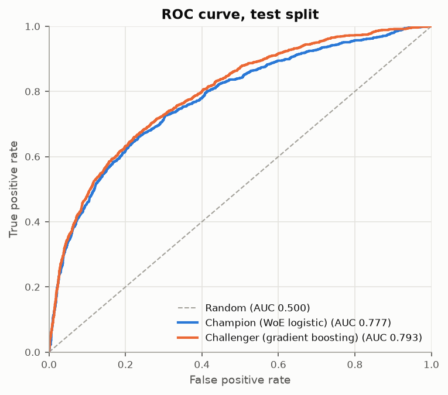
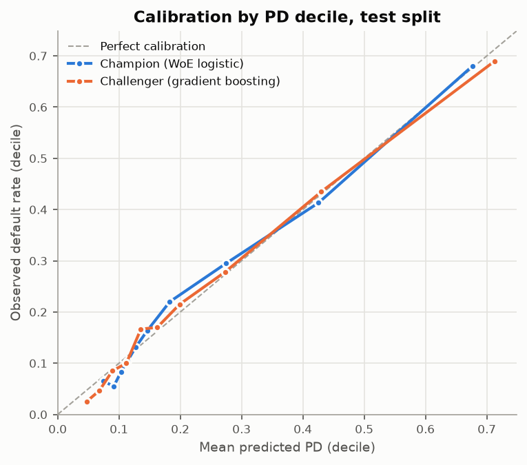
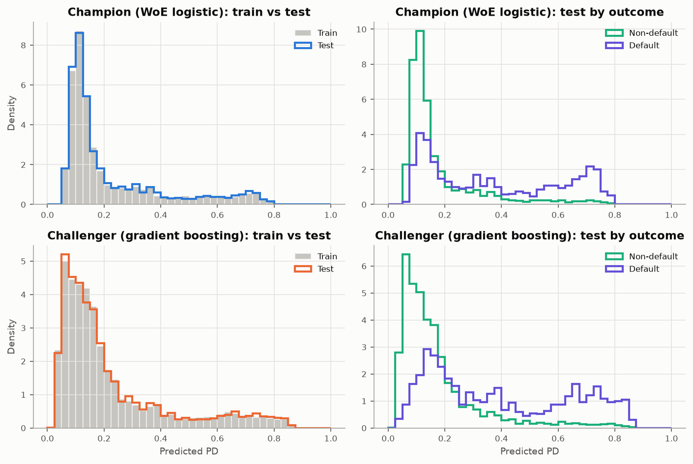

# Model validation report: credit-card probability of default

> Generated by `make report` from the pipeline outputs. Every figure and number below is computed by the code in `src/cdmv/`; nothing is typed in by hand. This is an independent portfolio project on public data, written in the format of a model-risk validation.

| Item | Description |
| :--- | :--- |
| Model | Probability of default (PD), next-month payment default, credit-card accounts |
| Champion | Champion (WoE logistic), 14 features, scorecard scaling 600 points at 50:1 odds, 20 points to double the odds |
| Challenger | Challenger (gradient boosting), 20 features |
| Data | UCI Default of Credit Card Clients, 30,000 accounts, Taiwan, 2005 |
| Validation scope | Data quality, methodology, discrimination, calibration, stability, sensitivity, benchmarking |

## Summary

The champion separates defaulters from non-defaulters with a test AUC of 0.777 and KS of 0.427, above the thresholds this report uses (AUC 0.70, KS 0.30). Mean predicted PD on test is 22.2% against an observed default rate of 22.1%. The gradient-boosting challenger reaches a test AUC of 0.793; the paired bootstrap difference is 0.016 (95% CI 0.009 to 0.022). 27 data-quality checks ran with 0 failures and 5 warnings for known, documented issues.

The validation raises 9 findings: 1 high, 5 medium, 3 low. The high-severity finding is the absence of an out-of-time test, which the data cannot support. The model is suitable as a documented demonstration of PD development and validation; it is not approved for decisions on real accounts.

### Headline metrics (test split)

| Model | AUC | Gini | KS | Brier | Mean PD |
| :--- | ---: | ---: | ---: | ---: | ---: |
| Champion (WoE logistic) | 0.777 | 0.555 | 0.427 | 0.1374 | 22.2% |
| Challenger (gradient boosting) | 0.793 | 0.587 | 0.438 | 0.1345 | 22.3% |

### Findings

| ID | Area | Severity | Finding | Recommendation |
| :--- | :--- | :--- | :--- | :--- |
| F1 | Stability | High | No out-of-time test is possible: the data covers one observation point (six monthly snapshots, April to September 2005) and one outcome month. The train/test PSI values reported below compare random samples of the same population, so they confirm the split, not stability over time. | Before any use beyond demonstration, test on a later vintage and set PSI monitoring triggers (0.10 review, 0.25 redevelop). |
| F2 | Calibration | Medium | Champion fails the Hosmer-Lemeshow test on test data (chi-square 22.3, 8 df, p = 0.0044). It over-predicts PD in deciles 1, 2, 3, 4 and 9 and under-predicts in deciles 5, 6, 7, 8 and 10; the largest gap is 3.7 pp. Mean PD (22.2%) matches the observed rate (22.1%). | Recalibrate (for example isotonic or Platt scaling on a holdout) before PD-level use such as loss forecasting; rank-ordering use is less affected. |
| F3 | Benchmark | Medium | The challenger's test AUC is higher by 0.016 (95% paired bootstrap CI 0.009 to 0.022), so the champion's simpler form gives up measurable discrimination. | Document the interpretability trade-off, or test whether interaction terms or coarser, monotone bins close the gap. |
| F4 | Methodology | Medium | 10 of 14 champion features have bins whose bad rate is not monotone (`min_pay_ratio_5m`, `n_months_status_zero_6m`, `n_months_zero_payment_6m`, `pay_ratio_m1`, `credit_limit`, `avg_util_6m`, `avg_pay_ratio_5m`, `util_change_6m`, `bill_growth_3m` and `pay_to_limit_6m`). Some reversals reflect real mass points (accounts with no bill or no payment); others look like noise from fine quantile bins. | Coarse-class these features with documented business rationale and refit. |
| F5 | Methodology | Low | 3 champion features change test AUC by less than 0.0005 when shuffled (`n_months_over_limit_6m`, `n_months_paid_duly_6m` and `pay_ratio_m1`). | Remove them for parsimony unless they are kept for business reasons. |
| F6 | Performance | Low | The challenger's train AUC exceeds its test AUC by 0.021; for the champion the train-minus-test gap is -0.006. The challenger shows some overfitting. | Tighten regularisation (fewer leaves, larger minimum leaf size) or use early stopping. |
| F7 | Performance | Low | Observed default rates across champion PD deciles are not strictly increasing: the rate falls from decile 1 to 2 (6.5% to 5.5%). | Recheck rank ordering in those deciles after coarse classing. |
| F8 | Data | Medium | Repayment status codes -2 and 0 are not defined in the source documentation but make up 66.9% of account-months. The model treats them as not delinquent, which is the common reading but is not confirmed. | Confirm code definitions with the data owner; rerun if the reading changes. |
| F9 | Governance | Medium | Development and validation were done by the same person. This report follows the structure of an independent validation but is not one. | Have an independent reviewer repeat the key tests. |

## 1. Purpose and intended use

The model estimates, for each credit-card account, the probability that the account defaults on its next monthly payment, using the previous six months of limit, billing, payment and repayment-status history. In a lending setting a PD model of this kind would feed account management (line decreases, collections prioritisation) and expected-loss estimates. Here the intended use is narrower: to show a reproducible development and validation process on public data. Out of scope: origination decisions, regulatory capital, and any decision about a real customer.

## 2. Data

Source: UCI Machine Learning Repository, dataset 350 (Yeh, 2009, CC BY 4.0). 30,000 credit-card accounts from a bank in Taiwan; one row per account; six monthly snapshots from April to September 2005 (unpivoted to 180,000 account-months in staging). The target is `default payment next month` (1 = default), with an overall default rate of 22.12%. The source does not define default more precisely (for example days past due), so the target definition is taken as given.

The split is stratified by target and done in SQL (`sql/features/020_model_split.sql`) by ordering accounts on an md5 hash of the account id and a fixed seed. Validation data is used only to choose hyperparameters; test data is used only for this report.

| Split | Accounts | Defaults | Default rate | Share |
| :--- | ---: | ---: | ---: | ---: |
| train | 18,000 | 3,982 | 22.12% | 60.0% |
| validation | 6,000 | 1,327 | 22.12% | 20.0% |
| test | 6,000 | 1,327 | 22.12% | 20.0% |

There is no time dimension beyond the six snapshots and a single outcome month, so the test split is an out-of-sample holdout from the same period, not an out-of-time sample (finding F1).

## 3. Data quality

Checks are SQL queries in `sql/dq/`, run by `src/cdmv/dq.py` after every build. A check with severity `error` and any failing rows stops the pipeline with a non-zero exit code; `warn` records a known issue that staging handles explicitly.

| Check | Layer | Rule | Severity | Failing rows | Rows | Status |
| :--- | :--- | :--- | :--- | ---: | ---: | :--- |
| RAW_01 | raw | Row count equals documented 30000 | error | 0 | 30,000 | PASS |
| RAW_02 | raw | ID is unique | error | 0 | 30,000 | PASS |
| RAW_03 | raw | No nulls in any of the 25 columns | error | 0 | 30,000 | PASS |
| RAW_04 | raw | Target is 0 or 1 | error | 0 | 30,000 | PASS |
| RAW_05 | raw | LIMIT_BAL is positive | error | 0 | 30,000 | PASS |
| RAW_06 | raw | AGE between 18 and 100 | error | 0 | 30,000 | PASS |
| RAW_07 | raw | SEX in documented codes {1,2} | error | 0 | 30,000 | PASS |
| RAW_08 | raw | PAY_0..PAY_6 within observed range [-2, 9] | error | 0 | 30,000 | PASS |
| RAW_09 | raw | PAY_AMT1..6 non-negative | error | 0 | 30,000 | PASS |
| RAW_10 | raw | EDUCATION in documented codes {1,2,3,4} (0/5/6 mapped to 4 in staging) | warn | 345 | 30,000 | WARN |
| RAW_11 | raw | MARRIAGE in documented codes {1,2,3} (0 mapped to 3 in staging) | warn | 54 | 30,000 | WARN |
| RAW_12 | raw | PAY_0..PAY_6 in documented codes {-1,1..9} (-2 and 0 are undocumented) | warn | 25,939 | 30,000 | WARN |
| RAW_13 | raw | BILL_AMT1..6 non-negative (negative = credit balance) | warn | 1,930 | 30,000 | WARN |
| RAW_14 | raw | BILL_AMT1..6 at or below LIMIT_BAL (above = over limit) | warn | 3,931 | 30,000 | WARN |
| STG_01 | staging | stg_accounts row count equals raw row count | error | 0 | 30,000 | PASS |
| STG_02 | staging | Every raw ID has exactly one staging row and vice versa | error | 0 | 30,000 | PASS |
| STG_03 | staging | Mapped EDUCATION in {1..4} and MARRIAGE in {1..3} | error | 0 | 30,000 | PASS |
| STG_04 | staging | stg_account_months has exactly 6 months per account | error | 0 | 30,000 | PASS |
| STG_05 | staging | Monthly bill and payment totals reconcile to raw | error | 0 | 30,000 | PASS |
| FEA_01 | features | account_features row count equals stg_accounts | error | 0 | 30,000 | PASS |
| FEA_02 | features | Every feature row joins to one staging account (unique key) | error | 0 | 30,000 | PASS |
| FEA_03 | features | No null or non-finite model features | error | 0 | 30,000 | PASS |
| FEA_04 | features | Payment ratios within [0, 1] | error | 0 | 30,000 | PASS |
| FEA_05 | features | Month counts within [0, 6] and status counts sum to 6 | error | 0 | 30,000 | PASS |
| FEA_06 | features | Streak logic: current <= longest <= delinquent months | error | 0 | 30,000 | PASS |
| FEA_07 | features | Every account is in exactly one split | error | 0 | 30,000 | PASS |
| FEA_08 | features | Split default rates within 0.5 pp of overall (stratification) | error | 0 | 30,000 | PASS |

Documented versus observed category codes (from `sql/profiles/category_codes.sql`; PAY counts are account-months across PAY_0 to PAY_6):

| Field | Code | Count | Documented meaning | Documented |
| :--- | ---: | ---: | :--- | :--- |
| EDUCATION | 0 | 14 | undocumented | **no** |
| EDUCATION | 1 | 10,585 | graduate school | yes |
| EDUCATION | 2 | 14,030 | university | yes |
| EDUCATION | 3 | 4,917 | high school | yes |
| EDUCATION | 4 | 123 | others | yes |
| EDUCATION | 5 | 280 | undocumented | **no** |
| EDUCATION | 6 | 51 | undocumented | **no** |
| MARRIAGE | 0 | 54 | undocumented | **no** |
| MARRIAGE | 1 | 13,659 | married | yes |
| MARRIAGE | 2 | 15,964 | single | yes |
| MARRIAGE | 3 | 323 | others | yes |
| PAY_0..PAY_6 | -2 | 24,415 | undocumented | **no** |
| PAY_0..PAY_6 | -1 | 34,640 | pay duly | yes |
| PAY_0..PAY_6 | 0 | 95,919 | undocumented | **no** |
| PAY_0..PAY_6 | 1 | 3,722 | payment delay 1 month(s) | yes |
| PAY_0..PAY_6 | 2 | 18,964 | payment delay 2 month(s) | yes |
| PAY_0..PAY_6 | 3 | 1,430 | payment delay 3 month(s) | yes |
| PAY_0..PAY_6 | 4 | 453 | payment delay 4 month(s) | yes |
| PAY_0..PAY_6 | 5 | 137 | payment delay 5 month(s) | yes |
| PAY_0..PAY_6 | 6 | 74 | payment delay 6 month(s) | yes |
| PAY_0..PAY_6 | 7 | 218 | payment delay 7 month(s) | yes |
| PAY_0..PAY_6 | 8 | 28 | payment delay 8 month(s) | yes |

Treatment: EDUCATION codes 0, 5 and 6 are mapped to 4 (others) and MARRIAGE code 0 to 3 (others), with flags kept in staging; neither field is a model input. PAY codes -2 and 0 are kept as distinct values and counted separately (`n_months_status_neg2_6m`, `n_months_status_zero_6m`); both are treated as not delinquent (`months_delinquent = greatest(pay_status, 0)`). A common reading is -2 = no balance or no use and 0 = revolving credit paid at least the minimum, but the source does not confirm this (finding F8). Negative bills are credit balances and bills above the limit are over-limit accounts; both are kept.

## 4. Methodology

### 4.1 Features

20 candidate features are built in SQL (`sql/features/010_account_features.sql`) from limit, bill, payment and repayment-status fields: utilisation level, peak and trend; bill growth; over-limit months; delinquency level, counts and streaks (gaps-and-islands on the monthly table); counts of each repayment-status type; payment ratios against the previous statement; zero-payment months; and payments relative to the limit. Definitions and lineage are in `docs/data_dictionary.md`.

Demographic fields (SEX, MARRIAGE, AGE, EDUCATION) are staged and quality-checked but not used. Sex, marital status and age are prohibited bases under the US Equal Credit Opportunity Act (age is allowed only under specific conditions in Regulation B), and education can act as a proxy. The data is from Taiwan, so this follows a US convention rather than the source jurisdiction's rules.

### 4.2 Champion: weight-of-evidence logistic regression

Each feature is binned on the training split: up to 10 quantile bins (or its distinct values when it has fewer), then adjacent bins are merged until each holds at least 5% of accounts and contains both outcomes. Each bin is replaced by its weight of evidence, WoE = ln(share of non-defaults / share of defaults), so higher WoE means lower risk. Features with information value (IV) below 0.02 are dropped, then, in order of IV, any feature whose WoE correlates above 0.7 with an already selected feature. Every coefficient must be negative (higher WoE, lower PD); a feature with a reversed sign is dropped and the model refit. The L2 penalty C is chosen on validation AUC.

| Feature | IV | Bins | Monotone bad rate | Decision | Reason |
| :--- | ---: | ---: | :--- | :--- | :--- |
| months_delinquent_m1 | 0.868 | 3 | yes | kept |  |
| n_months_delinquent_6m | 0.812 | 4 | yes | dropped | WoE correlation 0.75 with months_delinquent_m1 |
| longest_delinq_streak_6m | 0.795 | 4 | yes | dropped | WoE correlation 0.74 with months_delinquent_m1 |
| current_delinq_streak | 0.722 | 3 | yes | dropped | WoE correlation 0.90 with months_delinquent_m1 |
| max_months_delinquent_6m | 0.716 | 3 | yes | kept |  |
| min_pay_ratio_5m | 0.352 | 7 | no | kept |  |
| n_months_status_zero_6m | 0.280 | 7 | no | kept |  |
| n_months_zero_payment_6m | 0.255 | 5 | no | kept |  |
| pay_ratio_m1 | 0.208 | 8 | no | kept |  |
| credit_limit | 0.178 | 10 | no | kept |  |
| avg_util_6m | 0.138 | 10 | no | kept |  |
| avg_pay_ratio_5m | 0.108 | 9 | no | kept |  |
| max_util_6m | 0.104 | 10 | no | dropped | WoE correlation 0.85 with avg_util_6m |
| util_change_6m | 0.091 | 10 | no | kept |  |
| util_m1 | 0.077 | 10 | no | dropped | WoE correlation 0.75 with avg_util_6m |
| bill_growth_3m | 0.057 | 10 | no | kept |  |
| pay_to_limit_6m | 0.052 | 10 | no | kept |  |
| n_months_paid_duly_6m | 0.046 | 5 | yes | kept |  |
| n_months_over_limit_6m | 0.034 | 3 | yes | kept |  |
| n_months_status_neg2_6m | 0.008 | 3 | no | dropped | IV < 0.02 |

Validation AUC by C: C = 0.01: 0.7665, C = 0.1: 0.7658, C = 1: 0.7655, C = 10: 0.7655. Selected C = 0.01.

Coefficients (on WoE inputs) and the range of scorecard points each feature can contribute (full points table: `reports/tables/scorecard_points.csv`):

| Feature | Coefficient | Points range |
| :--- | ---: | ---: |
| intercept | -1.2420 |  |
| months_delinquent_m1 | -0.6402 | -2 to 48 |
| max_months_delinquent_6m | -0.2072 | 31 to 42 |
| min_pay_ratio_5m | -0.1288 | 35 to 41 |
| n_months_status_zero_6m | -0.2450 | 34 to 44 |
| n_months_zero_payment_6m | -0.2173 | 34 to 41 |
| pay_ratio_m1 | -0.0545 | 36 to 38 |
| credit_limit | -0.3464 | 31 to 44 |
| avg_util_6m | -0.3185 | 32 to 42 |
| avg_pay_ratio_5m | -0.1750 | 34 to 39 |
| util_change_6m | -0.2526 | 33 to 40 |
| bill_growth_3m | -0.2221 | 35 to 40 |
| pay_to_limit_6m | -0.2617 | 34 to 40 |
| n_months_paid_duly_6m | -0.0112 | 37 to 37 |
| n_months_over_limit_6m | -0.0040 | 37 to 37 |

### 4.3 Challenger: gradient boosting

scikit-learn `HistGradientBoostingClassifier` on all 20 raw features (no binning), with minimum leaf size 50 and L2 regularisation 1.0. A grid of 8 settings was searched on validation AUC (range 0.765 to 0.784); selected: learning rate 0.03, 8 leaves per tree, 400 trees. Full grid: `reports/tables/challenger_grid.csv`.

## 5. Performance

| Model | Split | Accounts | Default rate | Mean PD | AUC | Gini | KS | Brier | Log loss |
| :--- | :--- | ---: | ---: | ---: | ---: | ---: | ---: | ---: | ---: |
| Champion (WoE logistic) | train | 18,000 | 22.1% | 22.1% | 0.772 | 0.544 | 0.405 | 0.1367 | 0.4358 |
| Champion (WoE logistic) | validation | 6,000 | 22.1% | 22.1% | 0.767 | 0.533 | 0.403 | 0.1373 | 0.4378 |
| Champion (WoE logistic) | test | 6,000 | 22.1% | 22.2% | 0.777 | 0.555 | 0.427 | 0.1374 | 0.4359 |
| Challenger (gradient boosting) | train | 18,000 | 22.1% | 22.1% | 0.815 | 0.629 | 0.471 | 0.1268 | 0.4057 |
| Challenger (gradient boosting) | validation | 6,000 | 22.1% | 22.1% | 0.784 | 0.569 | 0.433 | 0.1327 | 0.4244 |
| Challenger (gradient boosting) | test | 6,000 | 22.1% | 22.3% | 0.793 | 0.587 | 0.438 | 0.1345 | 0.4255 |

Bootstrap 95% CIs for test AUC (1000 paired resamples): champion 0.763 to 0.793, challenger 0.780 to 0.808. Train-to-test AUC change: champion +0.006, challenger -0.021.

## 6. Calibration

**Champion (WoE logistic)**, test split. Hosmer-Lemeshow chi-square 22.31 on 8 df, p = 0.0044 (calibration rejected at 5%). Largest decile gap 3.7 pp; top-to-bottom decile default-rate ratio 10.5.

| Decile | Accounts | Defaults | PD range | Mean PD | Observed | Observed - predicted (pp) |
| :--- | ---: | ---: | :--- | ---: | ---: | ---: |
| 1 | 600 | 39 | 0.051 to 0.084 | 7.5% | 6.5% | -1.0 |
| 2 | 600 | 33 | 0.084 to 0.098 | 9.2% | 5.5% | -3.7 |
| 3 | 600 | 50 | 0.098 to 0.109 | 10.3% | 8.3% | -2.0 |
| 4 | 600 | 63 | 0.109 to 0.120 | 11.4% | 10.5% | -0.9 |
| 5 | 600 | 79 | 0.120 to 0.135 | 12.8% | 13.2% | +0.4 |
| 6 | 600 | 98 | 0.135 to 0.160 | 14.6% | 16.3% | +1.7 |
| 7 | 600 | 132 | 0.160 to 0.215 | 18.3% | 22.0% | +3.7 |
| 8 | 600 | 177 | 0.216 to 0.331 | 27.5% | 29.5% | +2.0 |
| 9 | 600 | 248 | 0.331 to 0.558 | 42.6% | 41.3% | -1.2 |
| 10 | 600 | 408 | 0.558 to 0.805 | 67.6% | 68.0% | +0.4 |

**Challenger (gradient boosting)**, test split. Hosmer-Lemeshow chi-square 19.68 on 8 df, p = 0.0116 (calibration rejected at 5%). Largest decile gap 3.1 pp; top-to-bottom decile default-rate ratio 27.6.

| Decile | Accounts | Defaults | PD range | Mean PD | Observed | Observed - predicted (pp) |
| :--- | ---: | ---: | :--- | ---: | ---: | ---: |
| 1 | 600 | 15 | 0.024 to 0.058 | 4.7% | 2.5% | -2.2 |
| 2 | 600 | 28 | 0.058 to 0.079 | 6.8% | 4.7% | -2.1 |
| 3 | 600 | 51 | 0.079 to 0.100 | 8.9% | 8.5% | -0.4 |
| 4 | 600 | 60 | 0.100 to 0.124 | 11.2% | 10.0% | -1.2 |
| 5 | 600 | 100 | 0.124 to 0.149 | 13.6% | 16.7% | +3.1 |
| 6 | 600 | 102 | 0.149 to 0.177 | 16.2% | 17.0% | +0.8 |
| 7 | 600 | 129 | 0.177 to 0.227 | 19.9% | 21.5% | +1.6 |
| 8 | 600 | 167 | 0.227 to 0.336 | 27.3% | 27.8% | +0.5 |
| 9 | 600 | 261 | 0.337 to 0.581 | 43.0% | 43.5% | +0.5 |
| 10 | 600 | 414 | 0.582 to 0.869 | 71.3% | 69.0% | -2.3 |

The Hosmer-Lemeshow test becomes very sensitive at this sample size (600 accounts per decile), so small absolute gaps can be statistically significant; the decile tables show the size and direction of each gap.

## 7. Stability

PSI compares the distribution of a score or feature in a comparison sample with the training sample: below 0.10 is read as stable, 0.10 to 0.25 as a moderate shift, above 0.25 as a significant shift. Score PSI uses deciles of the training PD; feature PSI uses the champion's WoE bins, fit on train.

| Model | Comparison | PSI | Reading |
| :--- | :--- | ---: | :--- |
| Champion (WoE logistic) | train vs validation | 0.0035 | stable |
| Champion (WoE logistic) | train vs test | 0.0010 | stable |
| Challenger (gradient boosting) | train vs validation | 0.0021 | stable |
| Challenger (gradient boosting) | train vs test | 0.0014 | stable |

Feature PSI, train vs test:

| Feature | PSI | Reading | In champion |
| :--- | ---: | :--- | :--- |
| max_util_6m | 0.0043 | stable | no |
| avg_util_6m | 0.0024 | stable | yes |
| util_change_6m | 0.0019 | stable | yes |
| pay_to_limit_6m | 0.0017 | stable | yes |
| pay_ratio_m1 | 0.0016 | stable | yes |
| util_m1 | 0.0012 | stable | no |
| bill_growth_3m | 0.0012 | stable | yes |
| n_months_status_zero_6m | 0.0010 | stable | yes |
| min_pay_ratio_5m | 0.0009 | stable | yes |
| n_months_zero_payment_6m | 0.0008 | stable | yes |
| n_months_paid_duly_6m | 0.0005 | stable | yes |
| credit_limit | 0.0005 | stable | yes |
| n_months_delinquent_6m | 0.0003 | stable | no |
| n_months_over_limit_6m | 0.0003 | stable | yes |
| avg_pay_ratio_5m | 0.0003 | stable | yes |
| max_months_delinquent_6m | 0.0003 | stable | yes |
| n_months_status_neg2_6m | 0.0002 | stable | no |
| months_delinquent_m1 | 0.0002 | stable | yes |
| longest_delinq_streak_6m | 0.0002 | stable | no |
| current_delinq_streak | 0.0001 | stable | no |

All values are stable (largest feature PSI 0.0043, `max_util_6m`). This is expected: the splits are random draws from one period, so these numbers check the split and the PSI code rather than stability over time (finding F1).

## 8. Sensitivity

Permutation importance: the drop in test AUC when one feature's values are shuffled (mean of 5 repeats). It measures how much each model relies on a feature, holding the fitted model fixed.

| Feature | In champion | Champion AUC drop | Challenger AUC drop |
| :--- | :--- | ---: | ---: |
| months_delinquent_m1 | yes | 0.0738 | 0.0468 |
| credit_limit | yes | 0.0105 | 0.0196 |
| max_months_delinquent_6m | yes | 0.0107 | 0.0186 |
| n_months_zero_payment_6m | yes | 0.0056 | 0.0051 |
| n_months_delinquent_6m | no | 0.0000 | 0.0044 |
| max_util_6m | no | 0.0000 | 0.0038 |
| avg_util_6m | yes | 0.0084 | 0.0038 |
| util_m1 | no | 0.0000 | 0.0037 |
| pay_to_limit_6m | yes | 0.0019 | 0.0036 |
| bill_growth_3m | yes | 0.0020 | 0.0033 |
| min_pay_ratio_5m | yes | 0.0026 | 0.0031 |
| util_change_6m | yes | 0.0011 | 0.0026 |

Both models rely most on `months_delinquent_m1`. The partial-dependence plots below show the mean predicted PD on a 2,000-account test sample as each of the challenger's top four features is varied across its training range, with all other features held at their observed values.

For the champion, the scorecard points range in section 4.2 gives the same view directly: `months_delinquent_m1` moves an account's score by up to 49 points, against 14 for `credit_limit` and 11 for `max_months_delinquent_6m` (20 points double or halve the odds).

Performance by credit-limit band (NT dollars; band edges are terciles of the training split):

| Credit limit | Accounts | Default rate | Champion AUC | Champion mean PD | Challenger AUC | Challenger mean PD |
| :--- | ---: | ---: | ---: | ---: | ---: | ---: |
| < 80,000 | 1,839 | 32.1% | 0.749 | 30.1% | 0.758 | 30.6% |
| [80,000, 200,000) | 1,922 | 20.4% | 0.773 | 22.5% | 0.793 | 22.7% |
| >= 200,000 | 2,239 | 15.4% | 0.759 | 15.4% | 0.789 | 15.2% |

## 9. Benchmark: champion versus challenger

| Measure | Champion (WoE logistic) | Challenger (gradient boosting) |
| :--- | ---: | ---: |
| Test AUC | 0.777 | 0.793 |
| Test KS | 0.427 | 0.438 |
| Test Brier | 0.1374 | 0.1345 |
| Hosmer-Lemeshow p (test) | 0.0044 | 0.0116 |
| Train-to-test AUC change | +0.006 | -0.021 |
| Features used | 14 | 20 |
| Explanation | Additive points per bin | Post-hoc (permutation, partial dependence) |

Paired bootstrap AUC difference (challenger minus champion): 0.016, 95% CI 0.009 to 0.022, which excludes zero. Spearman rank correlation between the two models' PDs on test: 0.911, so the two models largely agree on ordering and differ mainly at the margins. The champion is retained as the primary model because each prediction decomposes into points per feature, which supports adverse-action reasons and review; the challenger serves as the performance benchmark.

## 10. Limitations and model risks

- **No out-of-time or out-of-population test.** One observation window and one outcome month; performance on later periods, other economic conditions or other portfolios is unknown.
- **Old, foreign, single-lender data.** Taiwan, 2005, during a period of high card delinquency in that market; behaviour and the credit environment differ from current US portfolios.
- **Target definition.** "Default payment next month" is not defined in days past due or charge-off terms, and the one-month horizon is far shorter than the 12-month horizon typical for PD models.
- **Undocumented codes.** PAY -2 and 0 dominate the repayment-status fields and their meaning is inferred.
- **Payment-timing assumption.** The payment in month m is assumed to settle the statement of month m+1 (the previous statement); payment-ratio features depend on it.
- **No macroeconomic or bureau data.** The model cannot respond to economic conditions and has no external credit information.
- **Fine-classed bins.** WoE bins come from quantiles, not from reviewed coarse classes; some trends are non-monotone.
- **Fairness not tested.** Protected attributes are excluded as inputs, but no disparate-impact analysis was done; excluding a field does not remove proxies for it.
- **Self-validation.** The developer and validator are the same person.

## 11. Conclusions

1. Data quality: 27 checks, 0 failures. The known undocumented codes are handled explicitly and recorded as warnings.
2. Discrimination: the champion's test AUC of 0.777 (Gini 0.555, KS 0.427) is adequate for rank-ordering accounts by risk, and close to its train AUC.
3. Calibration: overall PD level is accurate (22.2% predicted vs 22.1% observed), but decile-level calibration is rejected (Hosmer-Lemeshow p = 0.0044).
4. Stability: PSI values are all stable, but this only reflects a random split; stability over time is untested.
5. Benchmark: the challenger is more discriminating by 0.016 AUC; the champion is kept for interpretability, and the gap is a documented finding.
6. Overall: fit for demonstration and for discussion of methodology. Use on real accounts would first require an out-of-time test, recalibration, coarse classing, confirmation of code definitions and an independent review.

## References

- Yeh, I. (2009). Default of Credit Card Clients [Dataset]. UCI Machine Learning Repository. https://doi.org/10.24432/C55S3H (CC BY 4.0).
- Yeh, I. C., & Lien, C. H. (2009). The comparisons of data mining techniques for the predictive accuracy of probability of default of credit card clients. *Expert Systems with Applications*, 36(2), 2473-2480.
- Board of Governors of the Federal Reserve System and OCC (2011). *Supervisory Guidance on Model Risk Management* (SR 11-7 / OCC 2011-12). Used as a structural reference only.
